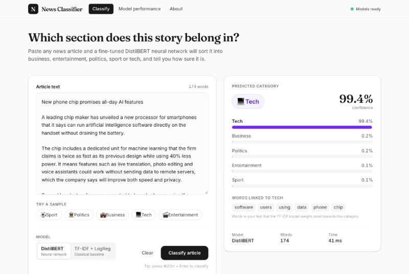
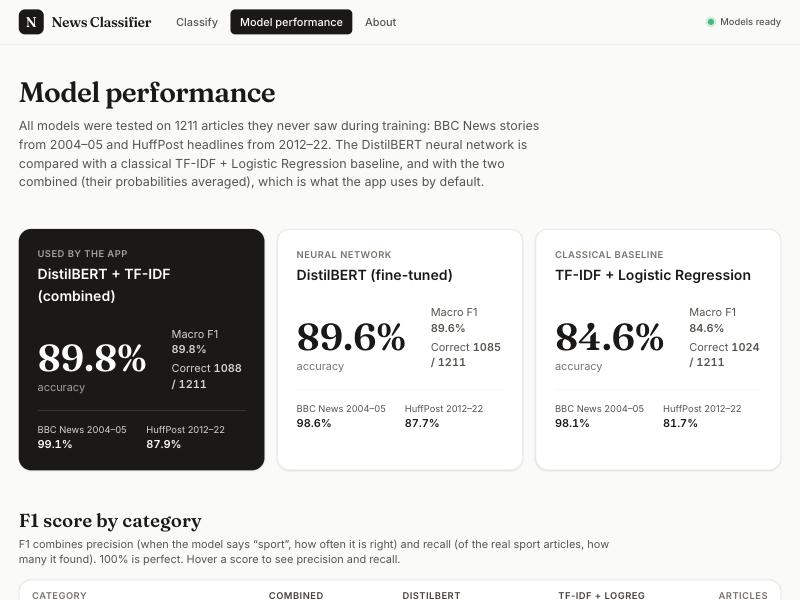

# News Article Classifier

**Problem statement:** automatically classify news articles into categories such as sports, politics, business and technology.

Paste a news article into the web app and a fine-tuned **DistilBERT** neural network predicts its category (business, entertainment, politics, sport or tech) with a confidence score for every category. A classical **TF-IDF + Logistic Regression** model is trained as a baseline. By default the app **combines** the two (averages their probabilities), which gives the same accuracy but more honest confidence scores, and shows an "Also related" topic when an article covers two subjects.





## Live demo

**https://news-classifier.assetdesk-archive-20261016.workers.dev**

The AI runs on Render's free plan, which normally sleeps after 15 minutes without visitors. A free Cloudflare scheduled task (`scheduled()` in `frontend/worker.js`, every 10 minutes) pings it so it stays awake, and each article takes about 0.1 s. If it ever is asleep (for example right after a redeploy fails), the site shows a "Waking up the AI…" window and the browser wakes it in about a minute.

## Results

Trained and tested on two datasets: **BBC News** (full articles, 2004–05) and **HuffPost** (headlines and summaries, 2012–22). The 1,211 test articles were never used for training. See [reports/REPORT.md](reports/REPORT.md) for the full write-up.

| Model | Overall | BBC 2004–05 | HuffPost 2012–22 |
|---|---|---|---|
| **Combined** (used by the app) | **89.8%** | **99.1%** | **87.9%** |
| DistilBERT (fine-tuned neural network) | 89.6% | 98.6% | 87.7% |
| TF-IDF + Logistic Regression (baseline) | 84.6% | 98.1% | 81.7% |
| *Version 1 DistilBERT, trained on BBC only* | — | *98.6%* | *68.1%* |

Adding modern news to the training data raised accuracy on modern news from 68% to 88% without losing anything on BBC. On 20 live BBC articles from November 2026, the combined model got 17 right (see [reports/manual_test.md](reports/manual_test.md)); the misses are stories the BBC itself filed under two sections. A larger live test on 42 articles from BBC, The Guardian and The Hindu scored 35 / 42 and passed all 21 edge cases (see [reports/live_test.md](reports/live_test.md)).

## How it works

```
News article ──► Tokenizer ──► DistilBERT (6-layer Transformer, 66M parameters) ──► Softmax ──► Category + confidence
```

1. **Data** (`training/prepare_data.py`): downloads the BBC News dataset (2,225 full articles, 2004–05) and the HuffPost News Category dataset (2,000 headlines + summaries per category, 2012–22), removes duplicates, and makes a stratified 80/10/10 train/validation/test split of each with a fixed seed.
2. **Baseline** (`training/train_baseline.py`): TF-IDF word and word-pair features + Logistic Regression.
3. **Neural model** (`training/train_bert.py`): fine-tunes `distilbert-base-uncased` with PyTorch, keeping the epoch with the best validation accuracy.
4. **Evaluation** (`training/evaluate.py`): scores DistilBERT and the combined model on the test split; every model writes to `reports/metrics.json` (overall and per dataset) and saves a confusion matrix image.
5. **API** (`backend/`): FastAPI loads both models once and serves predictions.
6. **Web app** (`frontend/`): React + Vite + Tailwind CSS, with Classify, Model performance and About pages.

## Project structure

```
news-classifier/
  training/     prepare_data.py, train_baseline.py, train_bert.py, evaluate.py, common.py
  backend/      main.py (API), classifier.py (model loading + prediction), tests/
  frontend/     React app (src/pages: Classify, Performance, About)
  scripts/      fetch_live_articles.py (test on today's BBC news)
  reports/      metrics.json, confusion matrices, screenshots/, REPORT.md, DEMO.md, manual_test.md, live_test.md
  data/         dataset and splits (created by prepare_data.py, not in git)
  models/       trained models (created by training, not in git)
  start.sh      build the frontend and run everything on one port
```

## Setup

Requires Python 3.10+ and Node.js 18+. On macOS/Linux:

```sh
python3 -m venv .venv
source .venv/bin/activate
pip install -r requirements.txt
npm --prefix frontend install
```

On Windows, activate with `.venv\Scripts\activate` instead.

## Train the models

Run from the project root with the virtual environment active:

```sh
python training/prepare_data.py     # download + split the data (seconds)
python training/train_baseline.py   # TF-IDF + Logistic Regression (seconds)
python training/train_bert.py       # fine-tune DistilBERT (about 25 min on an Apple M-series Mac, a few minutes on a GPU)
python training/evaluate.py         # test DistilBERT and save its metrics
```

The DistilBERT script uses an NVIDIA GPU or an Apple Silicon GPU automatically when available, and falls back to CPU (much slower). No GPU? Run the same scripts in Google Colab and copy the `models/distilbert/` folder back.

## Run the app

**One command** (builds the frontend, then serves everything at http://localhost:8000):

```sh
./start.sh
```

**Development mode** (hot reload), in two terminals:

```sh
uvicorn backend.main:app --reload --port 8000
```

```sh
npm --prefix frontend run dev    # then open http://localhost:5173
```

The frontend reads the API address from `VITE_API_URL` (default `http://localhost:8000` in development).

## Deploying

The live site has two parts:

| Part | Host | Cost |
|---|---|---|
| Website (`frontend/`) | Cloudflare Worker: static files + `/api` pass-through to Render | Free |
| AI API (`backend/`) | Render web service, free plan, Singapore | Free (sleeps when idle) |
| Model files | Public Hugging Face repo [`Radioactive012/news-classifier-models`](https://huggingface.co/Radioactive012/news-classifier-models) | Free |

Render's free plan has 512 MB of memory, and the PyTorch server needs about 800 MB. So the online server uses **ONNX Runtime** with an int8-compressed copy of DistilBERT instead (67 MB instead of 256 MB, about 400 MB of memory). It scores 89.7% on the test set against 89.8% for the full PyTorch model. The backend picks ONNX automatically when PyTorch is not installed; locally you can force it with `NEWS_ENGINE=onnx`.

**Update the AI after retraining:**

```sh
python training/export_onnx.py                       # writes models/distilbert_onnx/
hf upload Radioactive012/news-classifier-models models/distilbert_onnx distilbert_onnx
hf upload Radioactive012/news-classifier-models models/baseline.joblib baseline.joblib
```

Then trigger a new deploy on Render (it downloads the models during the build with `scripts/download_models.py`). Any push to `main` also redeploys it automatically. Build and start commands are in `render.yaml`.

**Update the website:**

```sh
cd frontend
npm run build          # .env.production points the app at /api
npx wrangler deploy
```

The website is a small Cloudflare Worker (`frontend/worker.js`). It serves the built React app and passes every `/api/...` request on to the Render server, so the browser only ever talks to one address. This avoids cross-site requests, which some browsers (such as Brave with Shields up) block.

## API

Interactive docs at http://localhost:8000/docs.

| Method | Path | Description |
|---|---|---|
| `POST` | `/predict` | Body `{"text": "...", "model": "combined" \| "distilbert" \| "baseline"}` (default `combined`). Returns the category, confidence, probabilities for every category, any "also related" categories (8% or more), key words and timing. Text under 20 words is rejected with a 422. |
| `GET` | `/metrics` | Test-set results for both models (`reports/metrics.json`). |
| `GET` | `/health` | Server status and which models are loaded. |

```sh
curl -X POST localhost:8000/predict -H 'Content-Type: application/json' \
  -d '{"text": "Shares in the bank fell sharply after it reported a drop in annual profits and warned that rising interest rates would hit lending to households and businesses."}'
```

## Tests

```sh
pytest                                # API tests
python scripts/fetch_live_articles.py # classify today's BBC articles -> reports/manual_test.md
python scripts/live_test.py           # test the LIVE site: today's BBC/Guardian/Hindu articles + 21 edge cases -> reports/live_test.md
```

## Limitations

- The newest training news is from 2022, so events and names since then can be misread.
- Each article gets exactly one of five labels, even when it covers two topics or none of them.
- DistilBERT reads at most 512 tokens (roughly 380 words) of each article.

## Credits

Dataset: D. Greene and P. Cunningham, "Practical Solutions to the Problem of Diagonal Dominance in Kernel Document Clustering", ICML 2006. Model: [DistilBERT](https://huggingface.co/distilbert-base-uncased) by Hugging Face. HuffPost data: R. Misra, "News Category Dataset", 2022 (CC BY 4.0).
