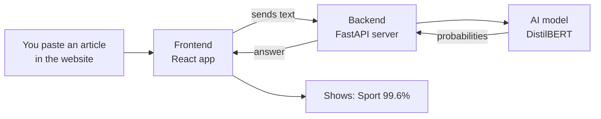
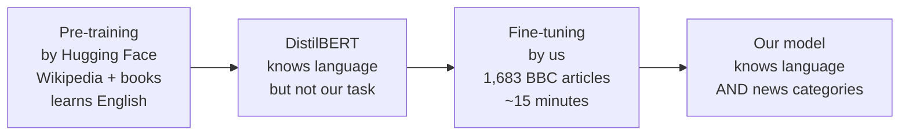
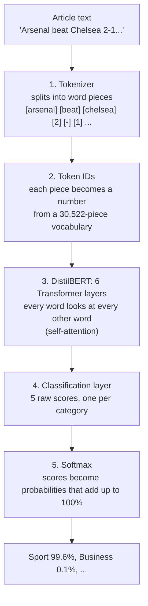
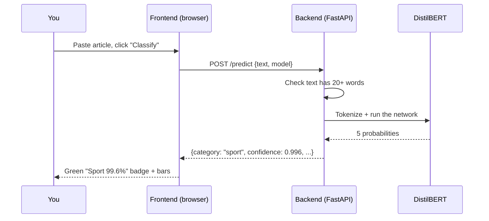

# 📰 News Classifier: the whole project, explained simply

> [!summary] In one sentence
> You paste a news article into a website, and an **AI model (a neural network called DistilBERT)** reads it and tells you whether it's **business, entertainment, politics, sport or tech**, and how sure it is.

This note assumes you know nothing. Read it top to bottom once, and you'll be able to explain every part of the project in your viva.

---

## 1. The problem

**Problem statement:** *Automatically classify news articles into categories such as sports, politics, business and technology.*

Websites like BBC or Times of India publish thousands of articles a day. Each one has to go into the right section (Sport, Business…). Doing it by hand is slow and boring. So we teach a computer to do it.

"Classify" just means **putting something into one of a fixed set of boxes**. Our boxes are:

| Box | Example headline |
|---|---|
| 💼 Business | "Supermarket profits fall as price war bites" |
| 🎬 Entertainment | "Debut film sweeps top prizes at awards night" |
| 🏛️ Politics | "Government faces rebellion over housing bill" |
| ⚽ Sport | "Late winner sends United into cup semi-final" |
| 💻 Tech | "New phone chip promises all-day AI features" |

---

## 2. The big picture



There are **three parts**:

1. **The AI models**: the "brain" that makes the decision. Built once by *training* on old news articles.
2. **The backend**: a small Python server that keeps the models loaded and answers questions like "what category is this text?"
3. **The frontend**: the website you see and click on.

> [!tip] An analogy
> - **Frontend** = the waiter who takes your order.
> - **Backend** = the kitchen.
> - **AI model** = the chef inside the kitchen.
> - **Training** = the years the chef spent at cooking school before the restaurant opened.

---

## 3. Basic AI words you need

| Word | What it means in plain English |
|---|---|
| **Machine learning (ML)** | Instead of writing rules ("if the text says *goal*, it's sport"), you show the computer thousands of examples and it figures out the rules itself. |
| **Model** | The thing that has learned. A file full of numbers that turns an input (article) into an output (category). |
| **Training** | The learning process: show examples, check the model's guesses, nudge its numbers to be less wrong, repeat. |
| **Dataset** | The collection of examples used for learning. Ours is 2,225 BBC articles that already have the correct label. |
| **Label** | The correct answer for an example, e.g. "sport". |
| **Neural network** | A type of model loosely inspired by the brain: layers of simple maths units ("neurons") connected by millions of adjustable numbers called **parameters** or **weights**. |
| **Deep learning** | Machine learning with neural networks that have many layers. |
| **NLP** | Natural Language Processing: AI that works with human language (text). This project is NLP. |
| **Inference / prediction** | Using an already-trained model on new input. This is what happens when you click "Classify". |
| **Accuracy** | Out of all test articles, the percentage the model got right. |

---

## 4. The data

### Where it comes from
The **BBC News dataset** (Greene & Cunningham, 2006): 2,225 real BBC articles from 2004–2005, each already labelled with one of the 5 categories. It's a well-known dataset used in research, which makes it a safe choice for a college project.

We download the **original version** from the publisher (`mlg.ucd.ie`). Other copies online had all the capital letters and commas removed, and we want training text to look like real articles people will paste in.

### Cleaning it (`training/prepare_data.py`)
1. **Read every article** and tidy up extra spaces.
2. **Remove duplicates.** The BBC sometimes published the same story twice with tiny edits. We found 121 of these and removed them, leaving **2,104 articles**.

> [!warning] Why duplicates matter (a good viva point)
> If the same story is in both the training set and the test set, the model has basically "seen the exam question before". Its test score would look better than it really is. This is called **data leakage**. We prevent it by removing near-duplicates *before* splitting.

### Splitting it: train / validation / test

We cut the data into three piles:

| Pile | Size | Used for | Analogy |
|---|---|---|---|
| **Train** (80%) | 1,683 | The model learns from these | Textbook and homework |
| **Validation** (10%) | 210 | Picking the best version while training | Mock exam |
| **Test** (10%) | 211 | Final score, used once at the very end | The real final exam |

- **Stratified** means each pile has the same mix of categories (e.g. ~24% business in each).
- **Random seed 42** means the shuffle is the same every time you run it, so results are **reproducible**. (42 is just a convention; any fixed number works.)

> [!important] The golden rule
> The model **never** learns from the test set. That's what makes the test score honest.

---

## 5. Model 1: the baseline (TF-IDF + Logistic Regression)

We build a simple, classic model first so we have something to compare the AI against. This is called a **baseline**. File: `training/train_baseline.py`.

### Step 1: TF-IDF turns words into numbers
Computers can't read; they only do maths. So each article becomes a long list of numbers, one per word (and per word pair, like "prime minister").

- **TF (term frequency):** how often the word appears in *this* article.
- **IDF (inverse document frequency):** how *rare* the word is across *all* articles.
- **TF × IDF:** high when a word is common here but rare elsewhere, which means it is **distinctive**.

Example: "the" appears everywhere, so it scores ~0. "Goalkeeper" appears a lot in this article but rarely overall, so it scores high, and that points to sport.

### Step 2: Logistic Regression learns a weight per word
For each category, it learns how much each word pushes towards it: "goalkeeper" gets a big positive weight for sport, "profits" for business. To classify, it adds up the weights of the words in the article, and the category with the biggest total wins.

> [!note] Limitation
> This model treats an article as a **bag of words**. It ignores order and context: "not good" and "good" look almost the same to it.

**Result: 99.1% accuracy** (209 of 211 test articles correct). It trains in seconds and the file is 3 MB.

---

## 6. Model 2: the AI (DistilBERT neural network) ⭐

This is the main "AI" part of the project. Files: `training/train_bert.py` and `training/evaluate.py`.

### What is DistilBERT?
- **BERT** is a famous language model made by Google in 2018. It's a **Transformer** neural network, the same family of technology behind ChatGPT and Claude, just much smaller.
- **DistilBERT** is a smaller, faster copy of BERT made by Hugging Face. It keeps about 97% of BERT's ability at 60% of the size.
  - **6 layers**
  - **66 million parameters** (adjustable numbers)
  - Already **pre-trained** on all of English Wikipedia plus thousands of books, so it already "understands" English before we touch it

### Pre-training vs fine-tuning (very important)



> [!tip] Analogy
> Pre-training = a person who went to school and can read well. Fine-tuning = giving that person a two-week job training as a newspaper sub-editor. We didn't teach it English from scratch (that would need huge computers); we taught an English reader our specific job. This is called **transfer learning**.

### How it reads an article (what happens when you click Classify)



**1. Tokenizer.** Splits text into "tokens" (words or word pieces). Unknown words get split into known pieces: "smartwatch" becomes "smart" + "##watch". We keep the first **512 tokens** (about 380 words), the maximum DistilBERT can read.

**2. Embeddings.** Each token becomes a list of 768 numbers that represents its meaning.

**3. Self-attention (the magic of Transformers).** Each word looks at every other word in the article to understand itself in context.
- "**Bank**" next to "river" means something different from "bank" next to "interest rates".
- The baseline can't do this. DistilBERT can.

**4. Classification head.** A small extra layer we added on top. It outputs 5 numbers, one per category.

**5. Softmax.** Converts those 5 numbers into percentages that add up to 100%. The biggest one is the answer, and its value is the "confidence".

### How training works (the learning loop)

For each **batch** of 16 articles:
1. **Forward pass:** the model guesses categories.
2. **Loss:** measure how wrong it was (we use **cross-entropy loss**: big when it's confidently wrong, near 0 when it's confidently right).
3. **Backward pass (backpropagation):** calculate how each of the 66 million numbers should change to reduce the loss.
4. **Optimiser step (AdamW):** nudge all the numbers a tiny bit in that direction.

Going once through all 1,683 training articles is called one **epoch**. We did **4 epochs**.

| Setting | Value | What it means |
|---|---|---|
| Epochs | 4 | Read the whole training set 4 times |
| Batch size | 16 | Learn from 16 articles at a time |
| Learning rate | 3e-5 (0.00003) | How big each nudge is. Too big and it forgets what it knew; too small and it learns slowly |
| Warm-up | first 10% of steps | Start with tiny nudges, then go to full size, then slowly shrink to 0 |
| Max length | 512 tokens | How much of each article it reads |
| Device | Apple M4 GPU (MPS) | Graphics chips do the maths much faster than the CPU |

After every epoch we test on the **validation** pile and **keep the best version**:

| Epoch | Training loss (lower = better) | Validation accuracy |
|---|---|---|
| 1 | 0.711 | 96.7% |
| 2 | 0.058 | 97.1% |
| 3 | 0.041 | **97.6% ← kept** |
| 4 | 0.013 | 97.1% |

> [!question] Why didn't we keep epoch 4 if its loss was lowest?
> Lower training loss means it's getting better at the *training* articles, but validation accuracy dropped slightly. That's an early sign of **overfitting**: memorising the textbook instead of understanding it. Picking the best validation epoch avoids this.

> [!note] We tried two settings
> A first run that read only 256 tokens for 3 epochs reached 96.2% on validation. Reading up to 512 tokens did better (97.6%), so we kept that. We chose using the **validation** set only, never the test set.

**Result: 98.6% test accuracy** (208 of 211 correct). The model file is 256 MB, and it takes about 35 ms per article.

---

## 7. Results: how good is it?

| Model | Test accuracy | Correct | Size | Speed |
|---|---|---|---|---|
| **DistilBERT** (AI) | **98.6%** | 208 / 211 | 256 MB | ~35 ms |
| TF-IDF + LogReg (baseline) | 99.1% | 209 / 211 | 3 MB | ~8 ms |

### Wait, the simple model scored higher?!

Yes, by **one article**, and you should say this honestly in your viva. It's a strength of the project, not a weakness:
- The BBC dataset is **easy**: each section uses very distinctive words. Keyword methods already get ~99% on it, which is well known in research.
- One article out of 211 is about 0.5%, which is within **noise**. They're effectively tied.
- On **brand-new 2026 BBC articles** (that neither model had seen, 21 years newer), **DistilBERT did better: 15/20 vs 14/20**.
- DistilBERT is more **confident** on clear articles (~99% vs 95–99%) and understands **context**, not just keywords.

> [!example] What it got wrong
> All 3 DistilBERT mistakes were **business** articles it called **politics**, for example a story about the Chancellor's economic rules. Economic policy made by politicians honestly belongs in both categories.

### Metrics explained
- **Accuracy:** % of articles classified correctly.
- **Precision (per category):** when the model says "sport", how often is it really sport?
- **Recall (per category):** of all real sport articles, how many did the model find?
- **F1 score:** one number that balances precision and recall (their harmonic mean).
- **Macro F1:** the average F1 across the 5 categories, treating each category equally.
- **Confusion matrix:** a 5×5 grid.
  - Rows = the real category; columns = what the model predicted.
  - Numbers on the diagonal are correct; anything off the diagonal is a mistake.
  - You can see it on the app's *Model performance* page.

---

## 7b. The overconfidence problem, and the "Combined" fix ⭐

> [!example] The article that exposed it
> An article about the **Indian government's renewable-energy investment programme**. It's mainly **business** (private investment, jobs, costs) with a **political** side (it's a government announcement).

| Model | Business | Politics |
|---|---|---|
| DistilBERT alone | 99.5% | 0.1% |
| TF-IDF baseline | 68% | 19% |
| **Combined (average of both)** | **83.6%** | **9.6%** |

**Why was DistilBERT so sure?** Every article it trained on had exactly **one** correct label. It never saw a "half business, half politics" article, so it learned to always be close to 100% sure. That's called being **overconfident** or **badly calibrated**.

**What we tried first:** *temperature scaling*, a standard trick that divides the model's raw scores by a number to soften them. We fitted that number on the validation set, but it barely helped (99.5% → 98.6%), because the validation articles are single-topic too.

**What we did:** average the two models' probabilities. This is called an **ensemble**.
- DistilBERT brings understanding of context.
- TF-IDF brings softer, more spread-out scores.
- Accuracy stayed exactly the same (98.6%), but the confidence is now more honest.

On the site, **Combined** is the default model. Any other category scoring **8% or more** is shown as **"Also related"**, so this article shows *Business 83.6% · Also related: Politics 9.6%*.

> [!tip] Viva gold
> "The neural network was overconfident on mixed-topic articles because it was trained on single-label data. Calibration didn't help, so I used an ensemble with the baseline. Accuracy was unchanged, the confidence became more realistic, and the app can now show a secondary topic." This shows you tested the model critically, not just trained it.

---

## 8. The backend (FastAPI)

File: `backend/main.py` and `backend/classifier.py`.

A **backend** is a program that runs on a computer (server) and answers requests. Ours is written in Python with **FastAPI**.

- When it starts, it **loads both models into memory once** (loading takes a few seconds, so we don't redo it for every click).
- It offers 3 **endpoints** (URLs the website can call). Together they form an **API** (Application Programming Interface):

| Endpoint | What it does |
|---|---|
| `POST /predict` | Send `{"text": "...", "model": "combined"}` and get back the category, confidence, all 5 probabilities, "also related" topics, key words and time taken. `model` can also be `distilbert` or `baseline` |
| `GET /metrics` | Returns the test results (from `reports/metrics.json`) for the performance page |
| `GET /health` | "Are you alive, and which models are loaded?" Powers the green "Models ready" dot |

**Safety checks:** it rejects empty text or text under 20 words with a clear message, and long articles are cut to 512 tokens rather than rejected.

**Key words feature:** the "Words linked to sport" chips come from the baseline model. For each word in your text, it multiplies the word's TF-IDF score by its learned weight for the predicted category and shows the top ones. It's a simple form of **explainable AI**: showing *why* a model decided.

**Interactive docs:** with the backend running, open `http://localhost:8000/docs` to try the API in your browser. This is a great thing to show examiners.

---

## 9. The frontend (React website)

Folder: `frontend/`. Built with:
- **React:** a JavaScript library for building interactive web pages out of components.
- **Vite:** the tool that runs the site while developing and bundles it for production.
- **Tailwind CSS:** styling (colours, spacing, layout) written as short class names.
- **Recharts:** draws the training chart.

### The 3 pages
1. **Classify (home)**
   - Text box with a word counter.
   - "Try a sample" buttons: 5 articles written for this project, so they're not in the training data.
   - Model switch (Combined, the default ↔ DistilBERT ↔ TF-IDF), which re-runs instantly so you can compare.
   - "Also related" chips when an article covers a second topic.
   - Result card: coloured badge, confidence %, bars for all 5 categories, key words, time taken.
   - A warning if confidence is under 60% ("may cover more than one topic").
   - Recent predictions history, saved in your browser.
2. **Model performance:** accuracy cards, per-category table, confusion matrices, training chart.
3. **About:** the problem, how it works in 3 steps, the dataset, limitations, tech stack.

It also handles **loading states** (grey placeholder while waiting), **errors** ("Backend offline"), and works on **phones**.

---

## 10. How everything connects (one click, start to finish)



---

## 11. Folder map

```
news-classifier/
├── training/          ← builds the AI (run once)
│   ├── prepare_data.py    download, clean, split the data
│   ├── train_baseline.py  train TF-IDF + Logistic Regression
│   ├── train_bert.py      fine-tune DistilBERT
│   ├── evaluate.py        test DistilBERT on the test set
│   └── common.py          shared code (paths, saving metrics)
├── backend/           ← the server
│   ├── main.py            the API endpoints
│   ├── classifier.py      loads models, makes predictions
│   └── tests/             15 automated tests
├── frontend/          ← the website
│   └── src/pages/         Classify, Performance, About
├── scripts/
│   └── fetch_live_articles.py  test on today's BBC news
├── reports/           ← results + college documents
│   ├── metrics.json       all the numbers
│   ├── REPORT.md          the project report
│   ├── DEMO.md            3-minute demo script
│   └── manual_test.md     live news results
├── data/   (not on GitHub) the dataset
├── models/ (not on GitHub) trained model files
├── start.sh           one command to run everything
├── README.md          setup instructions
└── DEPLOY_CODEX_PROMPT.md  how to put it online
```

> [!info] Why aren't `data/` and `models/` on GitHub?
> The DistilBERT model is 256 MB, too big for normal GitHub. Anyone can recreate both by running the training scripts.

---

## 12. How to run it

```bash
cd news-classifier
./start.sh
```
Then open **http://localhost:8000**. That's it. The models are already trained on your Mac.

To retrain from scratch:

```bash
source .venv/bin/activate
python training/prepare_data.py
python training/train_baseline.py
python training/train_bert.py      # ~15 min on your Mac
python training/evaluate.py
```

To run the tests: `pytest`

---

## 13. Tools & tech, and why each was chosen

| Tool | Role | Why |
|---|---|---|
| Python | Main language | The standard for AI |
| pandas | Reading CSV tables | Easy data handling |
| scikit-learn | Baseline model + metrics | Standard classic ML library |
| PyTorch | Runs and trains the neural network | Most popular deep learning library |
| Hugging Face Transformers | Gives us pre-trained DistilBERT | One line to download a world-class model |
| FastAPI | Backend server | Simple, fast, auto-generates `/docs` |
| React + Vite + Tailwind | Website | Modern, looks polished |
| pytest | Automated tests | Proves the API works |
| Git + GitHub | Version control | History of every change, backed up (private repo) |

---

## 14. Limitations (say these before the examiner does)

1. **Old data:** trained on 2004–05 British news, so it doesn't know about ChatGPT, current politicians, etc.
2. **One label only:** "Tech company's profits fall" is both tech and business, but it must pick one.
3. **Only 5 categories:** a science or health story gets forced into the closest box.
4. **512-token limit:** it reads only the first ~380 words of very long articles.
5. **Small test set:** 211 articles, so one mistake moves accuracy by ~0.5%.

## 15. Future improvements

- Train on a bigger, modern dataset with more categories.
- Allow multiple labels per article.
- Read long articles in chunks.
- Show which words DistilBERT itself focused on (attention visualisation).
- Deploy online (see `DEPLOY_CODEX_PROMPT.md`).

---

## 16. Likely viva questions, with answers

> [!question]- Where is the AI in this project?
> DistilBERT, a Transformer neural network with 66 million parameters, which we fine-tuned on BBC articles. It runs on the backend every time someone clicks Classify.

> [!question]- Did you train it from scratch?
> No. We used **transfer learning**: DistilBERT was already pre-trained on Wikipedia and books, and we fine-tuned it for our 5 categories. Training from scratch would need huge amounts of data and computing power.

> [!question]- Why use a baseline at all?
> To prove the neural network is worth it, and to have something to compare against. Without a baseline, "98.6%" has no context.

> [!question]- The baseline scored higher. Why use DistilBERT?
> They're tied within noise (1 article). DistilBERT did better on new 2026 articles, understands context and word order, and is more confident on clear cases. The BBC dataset is known to be keyword-friendly.

> [!question]- What's the difference between validation and test sets?
> Validation is used *during* development to pick the best epoch. Test is used *once* at the end for an honest final score. The model never learns from either.

> [!question]- What is overfitting?
> When a model memorises the training data instead of learning general patterns, so it does worse on new data. We watched validation accuracy and kept the best epoch to avoid it.

> [!question]- What is the "Combined" model?
> An ensemble: the average of DistilBERT's and the TF-IDF model's probabilities. Same accuracy as DistilBERT (98.6%), but less overconfident, so it can show a second related topic for mixed articles.

> [!question]- What is softmax?
> A function that turns raw scores into probabilities between 0 and 1 that add up to 1.

> [!question]- What is self-attention?
> Each word looks at every other word and decides how much each one matters for understanding it. That's how the model knows "bank" means different things in different sentences.

> [!question]- What is a token?
> A word or piece of a word. DistilBERT has a vocabulary of 30,522 tokens; rare words are split into smaller known pieces.

> [!question]- What loss function and optimiser did you use?
> Cross-entropy loss and the AdamW optimiser, learning rate 3e-5 with warm-up and linear decay.

> [!question]- How did you avoid data leakage?
> We removed 121 near-duplicate articles *before* splitting, so the same story can't appear in both training and test sets.

> [!question]- Why DistilBERT and not BERT or GPT?
> DistilBERT is 40% smaller and 60% faster than BERT with almost the same accuracy, and it trains on a laptop in ~15 minutes. GPT-style models generate text and are much larger; for picking one of 5 labels, a fine-tuned encoder like DistilBERT is the right tool.

> [!question]- Why not just call the ChatGPT or Claude API?
> It would cost money per request, need an internet connection and API key, and we couldn't show training, validation or test metrics, because we wouldn't have built or trained anything. Fine-tuning our own model is the actual machine-learning work.

> [!question]- How does the frontend talk to the backend?
> It sends an HTTP POST request with the article as JSON to `/predict`, and the backend replies with JSON containing the category and probabilities.

> [!question]- How do you know it works?
> 15 automated API tests (pytest), a held-out test set of 211 articles, and a live test on 20 current BBC articles.

---

## 17. Glossary (quick lookup)

- **API:** a set of URLs one program uses to talk to another.
- **Backpropagation:** the method for working out how to adjust each weight to reduce the loss.
- **Batch:** a group of examples processed together.
- **Epoch:** one full pass through the training data.
- **Fine-tuning:** further training a pre-trained model on your specific task.
- **GPU:** graphics chip, much faster than a CPU for neural network maths.
- **Hyperparameter:** a setting *you* choose (learning rate, epochs), as opposed to the parameters the model learns.
- **Inference:** using a trained model to make predictions.
- **Loss:** a number measuring how wrong the model is. Training tries to make it small.
- **MPS:** Apple's way of letting PyTorch use the Mac's GPU.
- **Parameter / weight:** one of the millions of numbers inside a model that training adjusts.
- **Pre-trained model:** a model someone else already trained on a large general dataset.
- **Seed:** a fixed number that makes "random" steps repeat exactly.
- **Transformer:** the neural network design behind BERT, GPT and Claude, built around self-attention.
