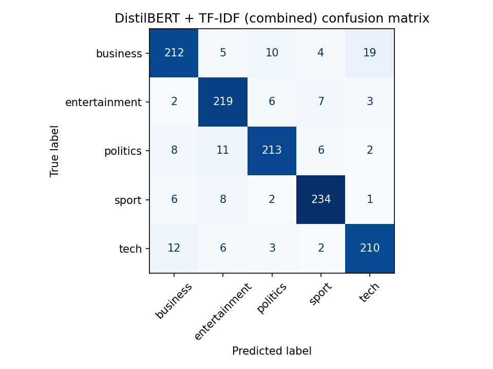
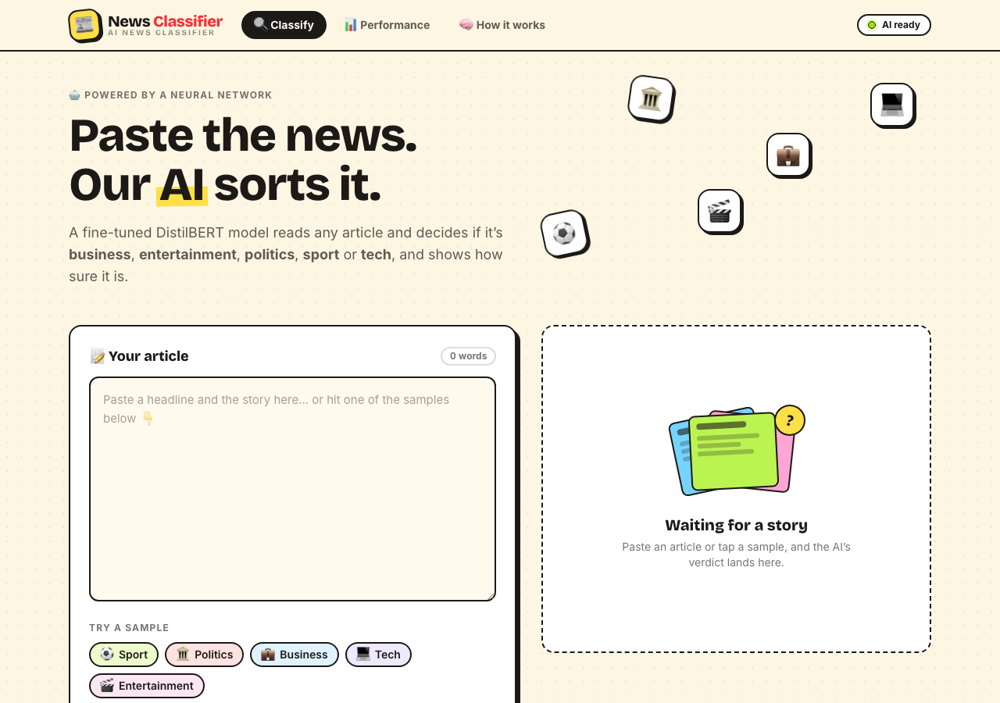
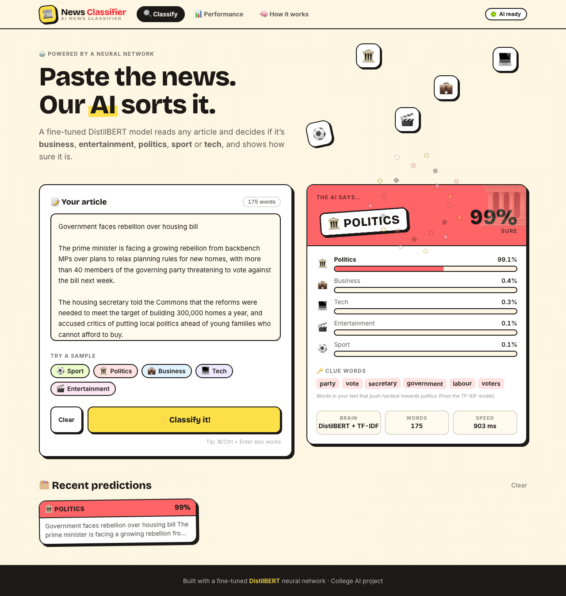
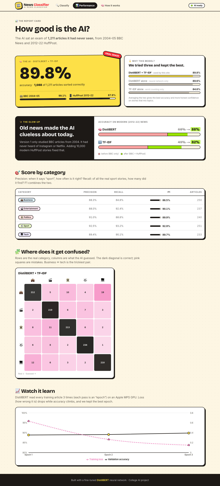
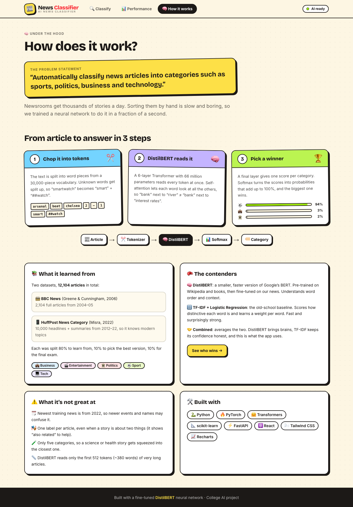

# News Category Classification System using NLP

## 1. Problem statement

Develop an NLP-based system to automatically classify news articles into predefined categories such as politics, sports, business, entertainment and technology.

This project uses **five categories**: business, entertainment, politics, sport and tech. These are the categories shared by both public datasets used (section 2), so every category has thousands of labelled examples. Other domains, such as health or science, are left for future work (section 8).

News organisations, aggregators and search engines handle thousands of articles a day, and each one needs a section. Doing this by hand is slow and inconsistent. The goal of this project is a working web application that takes the text of any news article and returns its category with a confidence score, using a neural network.

## 2. Datasets

Two public datasets with the same five categories: business, entertainment, politics, sport and tech.

| Dataset | Years | What each item is | Articles used |
|---|---|---|---|
| **BBC News** (Greene & Cunningham, ICML 2006) | 2004–05 | Full article, median about 380 words | 2,104 (after removing duplicates) |
| **HuffPost News Category** (Misra, 2022, CC BY 4.0) | 2012–22 | Headline plus one-sentence summary, median about 28 words | 10,000 (2,000 per category) |

The BBC data came from its publisher (mlg.ucd.ie), because that copy keeps capital letters and punctuation. HuffPost has 42 categories; six were mapped to ours:

| HuffPost category | Our category |
|---|---|
| BUSINESS, MONEY | business |
| ENTERTAINMENT | entertainment |
| POLITICS | politics |
| SPORTS | sport |
| TECH | tech |

The same number of HuffPost items was sampled from each category so that no category dominates.

**Why two datasets?** The first version of this project was trained on BBC articles only. It scored 98.6% on the BBC test set, but only **68.1% on modern HuffPost news** (and the TF-IDF baseline only 48.7%). Twenty-year-old training data was the model's main weakness, so modern news was added.

Each dataset is split on its own, 80/10/10 and stratified, so both appear in every split in the same proportions:

| Split | BBC | HuffPost | Total |
|---|---|---|---|
| Train | 1,683 | 8,000 | 9,683 |
| Validation | 210 | 1,000 | 1,210 |
| Test | 211 | 1,000 | 1,211 |

The BBC split is identical to the first version's, so BBC results can be compared directly.

## 3. Preprocessing

1. **Text cleaning.** Repeated spaces, tabs and line breaks are collapsed into one space, and empty articles are dropped. A few BBC files contain bytes that are not valid UTF-8 (such as a £ sign); these are replaced instead of crashing. HuffPost items become "headline. summary".
2. **Remove duplicates.**
   - BBC: 121 articles whose first 200 letters matched another article were removed. The BBC republished some stories with small edits, and copies in both the training and test sets would inflate the accuracy (data leakage).
   - HuffPost: repeated headlines were removed.
3. **Stratified split** with a fixed random seed (42), so every category has the same share in each split and results are reproducible.

4. **Lowercasing.** Both models lowercase the text. The TF-IDF vectoriser lowercases by default, and DistilBERT is the *uncased* model, whose tokenizer lowercases every word and removes accents. "Arsenal", "ARSENAL" and "arsenal" are therefore the same word.
5. **Tokenization.**
   - **TF-IDF:** the text is split into words (runs of two or more letters or digits). Punctuation is dropped, and single words and word pairs (bigrams) become features.
   - **DistilBERT:** WordPiece tokenization splits the text into sub-word pieces from a 30,522-piece vocabulary, so unknown words still get a representation ("smartwatch" becomes "smart" + "##watch").
6. **Stop-word removal** (TF-IDF only). Common English words with no topic meaning, such as "the", "and" and "is", are removed. DistilBERT keeps them, because word order and small words help it understand context.
7. **Feature extraction.** For TF-IDF, each article becomes a numerical vector (section 4.1). For DistilBERT, each token becomes a number (its ID in the vocabulary), and the network learns its own features.

The same lowercasing, tokenization and stop-word removal run at prediction time inside the saved models, so text a user pastes into the app is processed exactly like the training data.

The **validation** split is used only to choose the best training epoch, and the **test** split only for the final numbers. Neither is used for training.

## 4. Models

### 4.1 Baseline: TF-IDF + Logistic Regression

TF-IDF turns each article into a vector with one score per word and word pair (bigram). A word scores high when it is frequent in this article but rare across all articles. English stop words are removed, word pairs seen in only one article are dropped, and sublinear term frequency is used. Logistic Regression (C = 10) then learns one weight per feature per category.

### 4.2 Main model: fine-tuned DistilBERT

DistilBERT (`distilbert-base-uncased`) is a 6-layer Transformer neural network with 66 million parameters. Hugging Face pre-trained it on English Wikipedia and books by compressing the larger BERT model. A new classification layer with 5 outputs is placed on top, and the whole network is fine-tuned on the training articles (transfer learning).

- **Tokenisation:** WordPiece, with a 30,522-token vocabulary.
  - BBC articles are cut to their first 512 tokens (about 380 words).
  - HuffPost items to 128 tokens, which is more than enough for a headline and summary.
  - Each batch holds items from one dataset only, so short items are not padded to 512 tokens. This makes training more than twice as fast.
- **Training:**
  - AdamW optimiser, learning rate 3e-5 with 10% linear warm-up then linear decay, weight decay 0.01.
  - Batch size 16, 3 epochs, gradient clipping at 1.0, cross-entropy loss.
  - Batches from the two datasets are shuffled together.
- **Model selection:** the epoch with the highest validation accuracy is saved.
- **Hardware:** Apple M4 GPU (PyTorch MPS), about 8 minutes per epoch.

| Epoch | Training loss | Validation accuracy | BBC | HuffPost |
|---|---|---|---|---|
| 1 | 0.634 | 88.8% | 96.7% | 87.2% |
| 2 | 0.265 | 89.1% | 97.1% | 87.4% |
| 3 | 0.151 | **89.8%** (kept) | 97.1% | 88.3% |

### 4.3 Combined model (used by the app)

A fine-tuned network trained on single-label data learns to be very confident. Take an Indian government renewable-energy investment story: version 1 of DistilBERT said **business 99.5%, politics 0.1%**, even though the story has a clear political side.

The app therefore **averages the probabilities of DistilBERT and TF-IDF**. TF-IDF spreads its probabilities more evenly, which softens DistilBERT's overconfidence without lowering accuracy. Any other category scoring 8% or more is shown as **"Also related"**.

With the final models, the same energy story gives:

| Model | Result |
|---|---|
| Combined | **business 66.7%, politics 30.8%** (politics shown as related) |
| DistilBERT alone | business 90.1%, politics 9.1% |

## 5. Results

On the 1,211 test articles:

| Model | Overall accuracy | Macro F1 | BBC 2004–05 (211) | HuffPost 2012–22 (1,000) |
|---|---|---|---|---|
| **Combined** (used by the app) | **89.8%** | **89.8%** | **99.1%** | **87.9%** |
| DistilBERT (fine-tuned) | 89.6% | 89.6% | 98.6% | 87.7% |
| TF-IDF + Logistic Regression | 84.6% | 84.6% | 98.1% | 81.7% |
| *Version 1 DistilBERT (BBC only)* | — | — | *98.6%* | *68.1%* |
| *Version 1 TF-IDF (BBC only)* | — | — | *99.1%* | *48.7%* |

**What the metrics mean:**
- **Accuracy:** the share of all test articles classified correctly.
- **Precision:** when the model says "sport", how often it is right.
- **Recall:** of all the real sport articles, how many the model found.
- **F1 score:** the harmonic mean of precision and recall. **Macro F1** averages it over the five categories, so each counts equally.

Precision, recall and F1 per category for the **combined model** (used by the app):

| Category | Precision | Recall | F1 | Test articles |
|---|---|---|---|---|
| Business | 88.3% | 84.8% | 86.5% | 250 |
| Entertainment | 88.0% | 92.4% | 90.1% | 237 |
| Politics | 91.0% | 88.8% | 89.9% | 240 |
| Sport | 92.5% | 93.2% | 92.9% | 251 |
| Tech | 89.4% | 90.1% | 89.7% | 233 |
| **Macro average** | **89.8%** | **89.9%** | **89.8%** | **1,211** |

The same for the other two models (precision / recall / F1):

| Category | DistilBERT | TF-IDF + Logistic Regression |
|---|---|---|
| Business | 87.7% / 85.2% / 86.4% | 79.8% / 80.4% / 80.1% |
| Entertainment | 86.2% / 92.4% / 89.2% | 80.7% / 86.5% / 83.5% |
| Politics | 91.7% / 87.1% / 89.3% | 84.5% / 84.2% / 84.3% |
| Sport | 93.2% / 93.2% / 93.2% | 90.9% / 88.0% / 89.5% |
| Tech | 89.4% / 90.1% / 89.7% | 87.4% / 83.7% / 85.5% |

Every model was evaluated on the same 1,211 test articles. All numbers come from `reports/metrics.json`, written by `training/evaluate.py`.

Confusion matrices for all three models are in `reports/confusion_*.png` and on the app's Model performance page. The most common confusion is **business ↔ tech**: 19 business items predicted as tech and 12 the other way, for example stories about tech companies' finances. Next is **politics ↔ business/entertainment**.

### 5.1 Testing on real articles from different categories

To test the finished system on news it has never seen, `scripts/live_test.py` downloaded the day's articles from the RSS feeds of three outlets on 16 November 2026, three stories per category from each. It sent them to the live website. The section each outlet filed a story under is taken as its true category. Full results are in `reports/live_test.md`.

| Outlet | Country | Correct |
|---|---|---|
| BBC News | UK | 12 / 15 |
| The Guardian | UK | 11 / 15 |
| The Hindu | India | 12 / 12 |
| **Total** | | **35 / 42 (83%)** |

The 83% is lower than the 89.8% test accuracy, as expected for 2026 news and a writing style (Indian news) the model was never trained on. Most misses are borderline:
- **Stories filed under two sections.** The BBC filed the same Nvidia and Intel stories under both Business and Tech, so one answer always counts as wrong.
- **Stories that are about two topics.** A Russell Brand story filed under Entertainment was mostly about a Downing Street statement, and the model said Politics.

An earlier manual test (`reports/manual_test.md`) on 20 BBC articles from 15 November 2026 scored 17 / 20 with the combined model, against 15 / 20 for TF-IDF alone.

### 5.2 Edge cases

The same script sends 21 unusual inputs. **All 21 behaved as expected:**

| Input | What happens |
|---|---|
| Empty text, only spaces, fewer than 20 words | Rejected with a clear message (HTTP 422) |
| Over 50,000 characters, or a 300 KB upload | Rejected as too long (HTTP 413) |
| ALL CAPS, no punctuation, emoji, pasted HTML, quotes and brackets | Still classified correctly |
| A very long article | Classified from its first 512 tokens, and the app says it was shortened |
| Text saying "ignore all previous instructions…" | No effect; it is just text to the model |
| Gibberish, Hindi, numbers only, a recipe | Still given a category (see Limitations), usually with low confidence |

## 6. Discussion

**Modern data mattered more than model choice.** On the old BBC test set every model scores about 98–99%: the data is easy, and the models cannot be told apart. The modern HuffPost test separates them:

- Training on modern news raised DistilBERT from 68.1% to 87.7% on HuffPost.
- BBC accuracy stayed the same.

**The neural network generalises better.** Trained only on 2004–05 BBC news, DistilBERT still reached 68.1% on 2012–22 news, against 48.7% for TF-IDF. Pre-training on Wikipedia and books gave it general language knowledge that word counting cannot provide. With modern training data, DistilBERT still beats TF-IDF by 6 points on HuffPost.

**HuffPost is harder.** Each item is only a headline and one sentence (about 28 words), and categories overlap: a tech company's earnings could be business or tech. 88% on such short texts is a strong result.

**The combined model is the best of both.** It has the highest accuracy and gives more honest confidence on mixed-topic articles. The cost is speed and size: DistilBERT is 256 MB and takes about 35 ms per article on a CPU, against 4 MB and about 8 ms for TF-IDF.

## 7. Limitations

- **Data up to 2022:** events, people and products since then may be misread.
- **Different styles:** BBC data is British full articles and HuffPost is American headlines. Other countries' news or other writing styles may do slightly worse.
- **One label per article:** the "also related" display softens this, but the models were trained to give one answer.
- **Fixed categories:** there are only five. Science, health or world news is forced into the closest one.
- **Article length:** DistilBERT reads at most 512 tokens of each article.
- **Always picks a category:** text that is not news, gibberish or a language other than English still gets one of the five categories. The app warns when confidence is low, but a recipe was classified as business with 66% confidence.

## 8. Future work

- Add more modern full-length articles from several countries.
- Train for multiple labels per article, using a sigmoid output instead of softmax.
- Read long articles in several 512-token chunks and average the predictions.
- Try a larger model (RoBERTa or DeBERTa) now that the harder HuffPost test can show differences.
- Show which words DistilBERT itself relied on, with attention maps or integrated gradients.

## 9. System overview

- **Training:** Python, pandas, scikit-learn, PyTorch, Hugging Face Transformers.
- **Backend:** FastAPI. All models load once at startup and the server exposes three endpoints:
  - `POST /predict` for a prediction,
  - `GET /metrics` for the test results,
  - `GET /health` for server status.
- **Frontend:** React, Vite, Tailwind CSS and Recharts, with three pages:
  - **Classify:** text input, sample articles, confidence bars, "also related" topics, key words and history.
  - **Model performance:** accuracy cards with per-dataset scores, per-category table, confusion matrices and training curve.
  - **About.**
- **Tests:** 17 automated API tests (pytest) and a live test script for real articles and edge cases (`scripts/live_test.py`).

## 10. Screenshots

The live application at https://news-classifier.assetdesk-archive-20261016.workers.dev, captured on 21 November 2026.

**Figure 1. Classify page, ready for an article.**

**Figure 2. Classify page with a result.** The sample politics article is classified as Politics with 99% confidence. Every category has a bar, the clue words that pushed the decision are listed, and the prediction is saved under "Recent predictions".

**Figure 3. Model performance page:** accuracy, the comparison of the three models, precision, recall and F1 per category, the confusion matrix and the training curve.

**Figure 4. How it works page,** explaining tokenization, DistilBERT and softmax.

## 11. Conclusion

This project built a working NLP system that classifies news articles into five categories: business, entertainment, politics, sport and tech. It covers the whole pipeline:
1. Two public labelled datasets with 12,104 articles.
2. Text cleaning, lowercasing, tokenization and stop-word removal.
3. TF-IDF features with a Logistic Regression classifier.
4. A fine-tuned DistilBERT neural network, combined with TF-IDF.
5. Evaluation with accuracy, precision, recall, F1 and confusion matrices.
6. A web interface where anyone can paste an article and see its category.

The final combined model classifies **89.8%** of 1,211 unseen test articles correctly (macro F1 89.8%), against 84.6% for TF-IDF alone. On real articles published in November 2026 by three outlets in two countries it was right **35 times out of 42**, and it handled all 21 edge cases without errors.

The main lessons:
- **Training data mattered more than the choice of model.** Adding modern HuffPost news raised accuracy on modern news from 68% to 88%.
- **The pre-trained neural network generalises better** than word counting to news it was not trained on.
- **Averaging the two models** gave the best accuracy and more honest confidence on articles that mix topics.

The system's limits are its five fixed categories, one label per article, and training data that ends in 2022. Section 8 lists how to address them.
